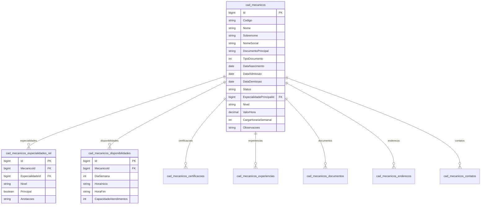

# Modelo de Dados: Detalhe de Mecânico (`/mecanicos/:id`)

**Feature**: `016-rota-mecanicos-id` | **Data**: 2026-11-04
**Referências de Governança**: [`governance/arquitetura.md`](file:///c:/Projetos/OficinaMotos/governance/arquitetura.md) e [`governance/inventario.md`](file:///c:/Projetos/OficinaMotos/governance/inventario.md)

---

## 1. Diagrama Entidade-Relacionamento (ERD)

---

## 2. Interfaces TypeScript Consumidas (`src/app/core/models/mecanico.ts`)

| Propriedade (`Mecanico`) | Tipo TypeScript | Origem | Exibição na Página de Detalhe |
|---|---|---|---|
| `id` | `number` | Parâmetro `:id` da rota / API | Identificador interno e link da rota |
| `codigo` | `string` | `MecanicoResponseDTO` | Badge de código funcional (ex.: `MEC-001`) |
| `nome` / `sobrenome` | `string` / `string \| null` | `MecanicoResponseDTO` | Título principal e iniciais do avatar |
| `nivel` | `string` | `MecanicoResponseDTO` | Subtítulo de senioridade (`Junior`, `Pleno`, `Senior`, `Especialista`) |
| `status` | `string` | `MecanicoResponseDTO` | Badge de status (`Ativo` / `Inativo`) |
| `valorHora` | `number` | `MecanicoResponseDTO` | KPI de Valor/Hora (`R$ 0,00`) |
| `cargaHorariaSemanal` | `number` | `MecanicoResponseDTO` | KPI de Carga Horária (`44h`) |
| `documentoPrincipal` | `string` | `MecanicoResponseDTO` | CPF exibido no card lateral de perfil |
| `dataAdmissao` | `string` | `MecanicoResponseDTO` | Data formatada (`dd/mm/aaaa`) no perfil |
| `especialidades` | `MecanicoEspecialidadeRel[]` | `MecanicoResponseDTO` | Aba 0 — Especialidades Técnicas |
| `disponibilidades` | `MecanicoDisponibilidade[]` | `MecanicoResponseDTO` | Aba 1 — Disponibilidade Semanal |
| `certificacoes` | `MecanicoCertificacao[]` | `MecanicoResponseDTO` | Aba 2 — Certificações & Cursos |
| `experiencias` | `MecanicoExperiencia[]` | `MecanicoResponseDTO` | Aba 3 — Experiência Profissional |
| `documentos` | `MecanicoDocumento[]` | `MecanicoResponseDTO` | Aba 4 — Documentos |
| `enderecos` | `MecanicoEndereco[]` | `MecanicoResponseDTO` | Aba 5 — Endereços |
| `contatos` | `MecanicoContato[]` | `MecanicoResponseDTO` | Aba 6 — Contatos |

