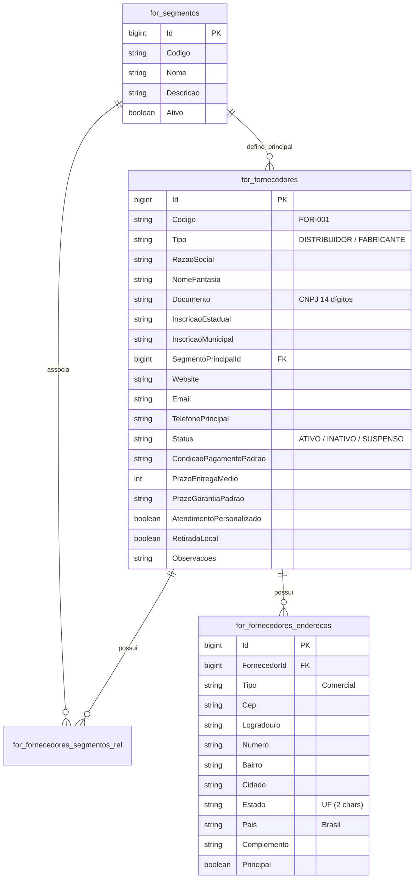

# Modelo de Dados: Cadastro de Fornecedor (`/fornecedores/novo`)

**Feature**: `017-cadastro-fornecedor` | **Data**: 2026-11-04
**Referências de Governança**: [`governance/arquitetura.md`](file:///c:/Projetos/OficinaMotos/governance/arquitetura.md) e [`governance/inventario.md`](file:///c:/Projetos/OficinaMotos/governance/inventario.md)

---

## 1. Diagrama Entidade-Relacionamento (ERD)

---

## 2. Dicionário de Dados do Formulário

| Controle no Formulário | Tipo C# (`DTO`) | Tipo TS | Regras de Validação | Descrição |
|---|---|---|---|---|
| `codigo` | `string` | `string` | Obrigatório, max 40 chars | Código identificador (ex.: `FOR-001`) |
| `tipo` | `string` | `string` | Obrigatório | `DISTRIBUIDOR`, `FABRICANTE`, `IMPORTADOR`, `VAREJISTA`, `PRESTADOR_SERVICO` |
| `razaoSocial` | `string` | `string` | Obrigatório, min 3, max 200 | Razão Social jurídica |
| `nomeFantasia` | `string` | `string` | Obrigatório, min 2, max 160 | Nome comercial / fantasia |
| `documento` | `string` | `string` | Obrigatório, `cnpjValidator()` | CNPJ com máscara `00.000.000/0000-00` |
| `inscricaoEstadual` | `string?` | `string` | Opcional, max 40 chars | Inscrição Estadual |
| `inscricaoMunicipal` | `string?` | `string` | Opcional, max 40 chars | Inscrição Municipal |
| `segmentoPrincipalId` | `long?` | `number \| null` | Opcional | Selecionado via dropdown dinâmico |
| `status` | `string` | `string` | Obrigatório, default `'ATIVO'` | `ATIVO`, `INATIVO`, `SUSPENSO` |
| `email` | `string?` | `string` | Opcional, `Validators.email` | E-mail comercial principal |
| `telefonePrincipal` | `string?` | `string` | Opcional | Telefone/WhatsApp formatado |
| `website` | `string?` | `string` | Opcional, max 200 chars | URL do site do fornecedor |
| `condicaoPagamentoPadrao` | `string?` | `string` | Opcional, max 100 chars | Ex.: `28/56 dias`, `À vista` |
| `prazoEntregaMedio` | `int?` | `number \| null` | Opcional, `Validators.min(0)` | Prazo médio de entrega em dias |
| `prazoGarantiaPadrao` | `string?` | `string` | Opcional, max 100 chars | Ex.: `90 dias` |
| `atendimentoPersonalizado` | `bool` | `boolean` | Default `false` | Possui consultor dedicado |
| `retiradaLocal` | `bool` | `boolean` | Default `false` | Permite retirada no balcão |
| `observacoes` | `string?` | `string` | Opcional, max 500 chars | Observações gerais |
| `cep` | `string?` | `string` | Opcional, `cepValidator()` | CEP para consulta no `CepService` |
| `logradouro` | `string` | `string` | Preenchido via CEP ou manual | Rua / Avenida |
| `numero` | `string` | `string` | Opcional / Manual | Número do endereço |
| `complemento` | `string?` | `string` | Opcional | Sala, Galpão, Bloco |
| `bairro` | `string` | `string` | Preenchido via CEP ou manual | Bairro |
| `cidade` | `string` | `string` | Preenchido via CEP ou manual | Município |
| `estado` | `string` | `string` | Preenchido via CEP (`uf`) ou manual | Sigla UF (2 caracteres) |

