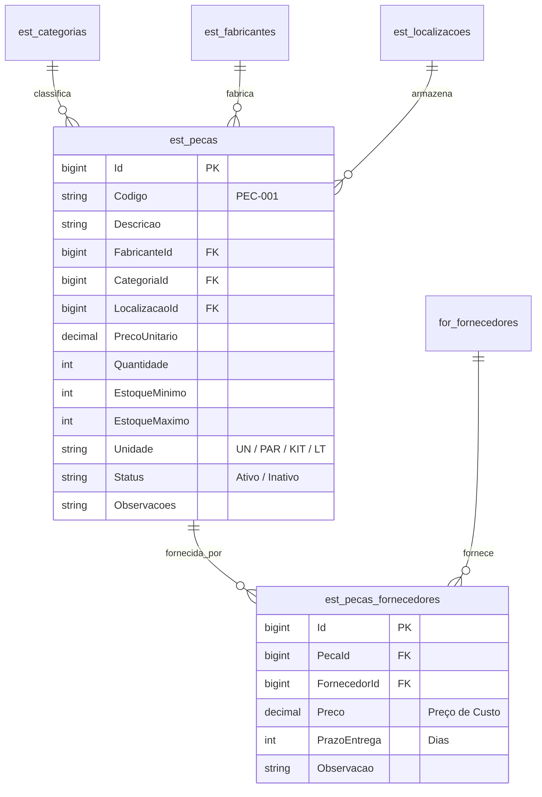

# Modelo de Dados: Cadastro de Peça no Estoque (`/estoque/novo`)

**Feature**: `018-cadastro-peca-estoque` | **Data**: 2026-11-04
**Referências de Governança**: [`governance/arquitetura.md`](file:///c:/Projetos/OficinaMotos/governance/arquitetura.md) e [`governance/inventario.md`](file:///c:/Projetos/OficinaMotos/governance/inventario.md)

---

## 1. Diagrama Entidade-Relacionamento (ERD)

---

## 2. Dicionário de Dados do Formulário

| Controle no Formulário | Tipo C# (`DTO`) | Tipo TS | Regras de Validação | Descrição |
|---|---|---|---|---|
| `codigo` | `string` | `string` | Obrigatório, max 40 chars | Código/SKU da peça (ex.: `PEC-001`) |
| `descricao` | `string` | `string` | Obrigatório, min 3, max 200 | Nome/descrição técnica da peça |
| `unidade` | `string` | `string` | Obrigatório, default `'UN'` | `UN`, `PAR`, `KIT`, `LT`, `MT`, `KG` |
| `status` | `string` | `string` | Obrigatório, default `'Ativo'` | `Ativo`, `Inativo` |
| `categoriaId` | `long?` | `number \| null` | Opcional | Selecionado via dropdown de categorias (`T-018.3`) |
| `fabricanteId` | `long?` | `number \| null` | Opcional | Selecionado via dropdown de fabricantes (`T-018.3`) |
| `fornecedorId` | `long` (Rel) | `number \| null` | Opcional | Selecionado via dropdown de fornecedores (`T-018.3`) |
| `localizacaoId` | `long?` | `number \| null` | Opcional | Selecionado via dropdown de localizações |
| `precoUnitario` | `decimal` | `number` | Obrigatório, `Validators.min(0.01)` | Preço unitário de venda (R$) |
| `precoFornecedor` | `decimal?` | `number \| null` | Opcional, `Validators.min(0)` | Preço de custo no fornecedor (R$) |
| `prazoEntregaFornecedor` | `int?` | `number \| null` | Opcional, `Validators.min(0)` | Prazo de entrega do fornecedor (dias) |
| `quantidade` | `int` | `number` | Obrigatório, `Validators.min(0)` | Saldo inicial em estoque |
| `estoqueMinimo` | `int` | `number` | Obrigatório, `Validators.min(0)` | Quantidade mínima de segurança (`qtd_minima`) |
| `estoqueMaximo` | `int` | `number` | Obrigatório, `Validators.min(0)` | Capacidade máxima planejada |
| `observacoes` | `string?` | `string` | Opcional, max 500 chars | Aplicações, compatibilidade, notas |

